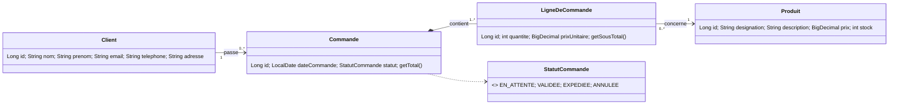

# Gestion des commandes — JEE MVC (Servlet / JSP / JSTL / JDBC)

Application web de gestion de commandes réalisée pour l'atelier **« Application web basée sur MVC1 et Standards JEE »** (FST Tanger, cycle ingénieur LSI, encadrant : Pr. Elaachak).

Elle gère trois espaces : **clients**, **produits** et **commandes** (avec leurs lignes), sur MySQL, avec Tomcat 9.

## Fonctionnalités

- CRUD complet des clients et des produits, avec validation des saisies (e-mail unique, prix à 2 décimales, stock ≥ 0).
- Commandes : création avec plusieurs lignes, ajout, modification et retrait de lignes tant que la commande est « En attente », filtre par statut, total calculé.
- Cycle de vie d'une commande : `EN_ATTENTE → VALIDEE → EXPEDIEE`, avec annulation possible depuis `EN_ATTENTE` ou `VALIDEE`.
- Stock réservé à la création d'une ligne et restitué à l'annulation ou à la suppression. Le prix de la ligne est figé au moment de la commande.
- Interface responsive, sans dépendance externe (CSS et JS locaux).

## Architecture

```
Navigateur ──► Servlet (contrôleur) ──► DAO (interface) ──► MySQL
                    │                        ▲
                    ▼                        │
               JSP + JSTL (vue)        Entités (JavaBeans)
```

| Package / dossier | Rôle |
|---|---|
| `ma.fstt.entities` | Modèle : `Client`, `Produit`, `Commande`, `LigneDeCommande`, `StatutCommande` |
| `ma.fstt.service` | Interfaces `IDao`, `IClientDao`, … et exceptions métier |
| `ma.fstt.dao` | Implémentations JDBC, transactions, règles de stock |
| `ma.fstt.web` | Servlets contrôleurs, filtre (UTF-8, CSRF, en-têtes), messages flash |
| `src/main/webapp/WEB-INF/views` | Pages JSP (JSTL/EL uniquement, scriptlets interdits) |
| `src/main/webapp/WEB-INF/tags` | Gabarit commun (`layout`), montants, statuts, jeton CSRF |
| `db/schema.sql` | Schéma MySQL et jeu de données d'exemple |
| `docs/` | Diagramme de classes (Mermaid et TikZ) |

### Choix de conception

- **Interfaces DAO injectées (CDI/Weld)** : les servlets dépendent d'interfaces, pas d'implémentations, ce qui permet de changer de persistance sans toucher aux contrôleurs.
- **Transactions et concurrence** : les écritures passent par un helper transactionnel. La mise à jour du stock est conditionnelle (`stock + ? >= 0`), donc deux commandes simultanées ne peuvent pas le rendre négatif.
- **Post/Redirect/Get** : chaque POST se termine par une redirection, ce qui évite les doubles soumissions au rafraîchissement.
- **Sécurité** : jeton CSRF sur tous les formulaires, échappement systématique des sorties (`<c:out>`), cookie de session `HttpOnly`, requêtes préparées partout.

## Modèle de données



Version détaillée : [`docs/class-diagram.md`](docs/class-diagram.md).

## Installation et exécution

### Prérequis

- JDK 17, Maven 3.9+
- MySQL 8.0.16 ou plus récent (les contraintes `CHECK` ne sont appliquées qu'à partir de cette version)
- Apache Tomcat 9 (espace de noms `javax.*`, **pas** Tomcat 10)
- Eclipse IDE for Enterprise Java and Web Developers (optionnel)

### 1. Base de données

```bash
mysql -u root -p < db/schema.sql
```

Le script recrée la base `gestion_commandes` et insère quelques données d'exemple.

### 2. Configuration

Copier le modèle puis renseigner le mot de passe MySQL :

```bash
cp src/main/resources/db.properties.example src/main/resources/db.properties
```

Le fichier `db.properties` est ignoré par Git. Les variables d'environnement `DB_URL`, `DB_USER` et `DB_PASSWORD` ont priorité sur le fichier.

### 3. Lancer

**Avec Eclipse** : importer le projet Maven, ajouter un serveur Tomcat v9.0, puis *Add and Remove* → `gestion-commandes` → *Start*.

**En ligne de commande** :

```bash
mvn clean package
cp target/gestion-commandes-1.0.0.war "$CATALINA_HOME/webapps/gestion-commandes.war"
"$CATALINA_HOME/bin/startup.sh"      # startup.bat sous Windows
```

Application disponible sur `http://localhost:8080/gestion-commandes/` (adapter le port si 8080 est occupé).

## Tests réalisés

- Couche DAO : scénarios automatisés (règles de stock, statuts, contraintes, concurrence) exécutés contre une vraie base.
- Couche web : parcours de bout en bout sur Tomcat 9 (rendu des pages, CSRF, UTF-8, échappement XSS, validations, erreurs 400/403/404).
- Ces scénarios ont été exécutés sur MariaDB. Le déploiement sur MySQL 8 avec Weld a été validé manuellement.

## Limites connues

- Connexions ouvertes par `DriverManager`, sans pool. Un `DataSource` (HikariCP ou pool Tomcat) serait la suite logique.
- Pas d'authentification ni de rôles.
- `ProduitDao.update` écrase le stock avec la valeur saisie, ce qui n'est pas adapté à une modification concurrente.
- Pas de pagination des listes.

## Convention de commits

[Conventional Commits](https://www.conventionalcommits.org/) : `feat`, `fix`, `style`, `docs`, `chore`.

## Rapport

Le rapport de l'atelier est disponible dans [
eport/rapport-jee-gestion-commandes.pdf](report/rapport-jee-gestion-commandes.pdf) (sources LaTeX : 
eport/main.tex).

